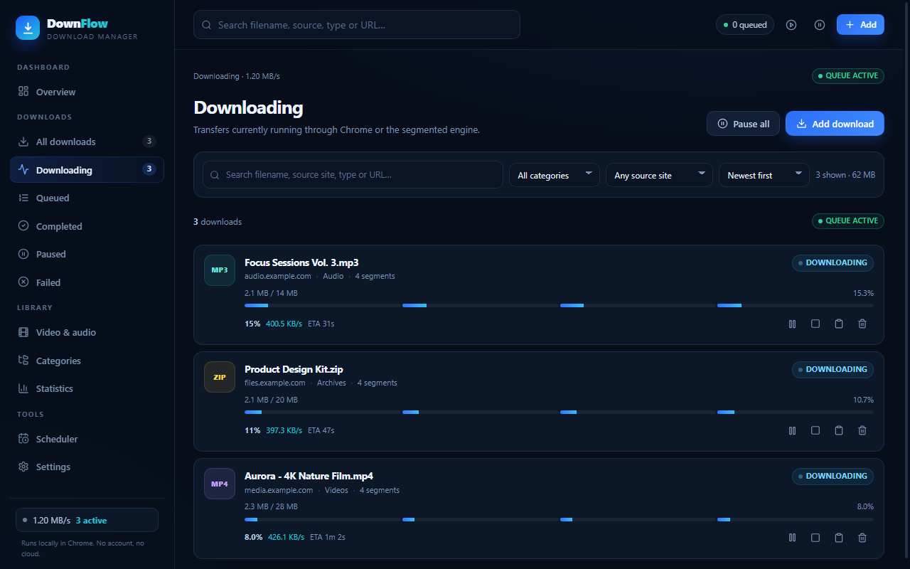
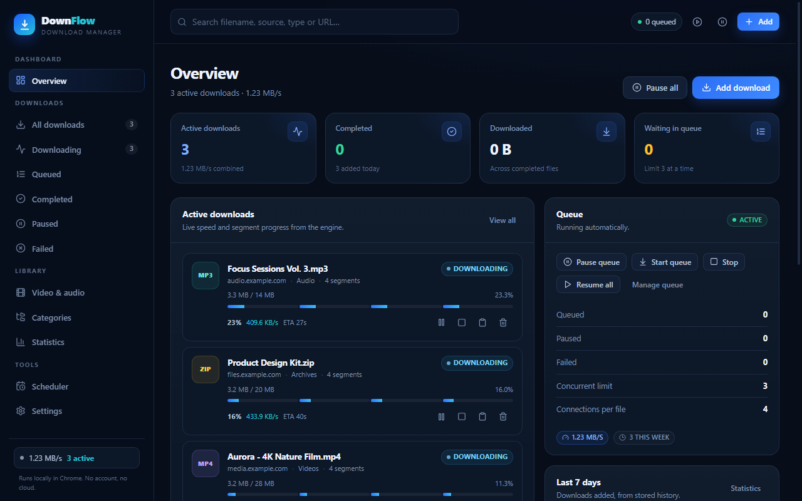

# DownFlow

DownFlow is a local-first download manager built entirely as a Chrome Manifest V3
extension. It combines Chrome's native Downloads API with a custom HTTP Range/OPFS
segmented engine, and adds a modern dark dashboard, queueing, scheduling, media
detection, categories and statistics.

Everything runs inside Chrome and the extension's own local storage. There is no
desktop app, external backend, paid service or remotely hosted code. An **optional
native helper** is available for real video-site downloads (YouTube and other
yt-dlp-supported sites); it runs yt-dlp locally, is installed explicitly by the
user, and the extension stays honest when it is absent. See
[docs/VIDEO_SITES.md](docs/VIDEO_SITES.md).

> **Honesty note:** DownFlow does not bypass DRM, paywalls, authentication, or
> website access controls. It cannot replace every website's download handler, and
> it does not claim universal interception or guaranteed acceleration. Segmented
> transfers are used only when the server and file safely support them; otherwise
> DownFlow falls back to Chrome's standard engine and shows a **Standard mode** chip.

## Screenshots

These are real captures of three segmented downloads in progress against a
throttled local test server — the percentages, speeds, ETAs and segment strips
come from the running engines. Regenerate them with `npm run screenshots`.





## Feature overview

- **Popup** with active downloads, progress, speed, ETA, pause/resume/cancel,
  pause-all/resume-all, add download, media, scheduler and dashboard shortcuts.
- **Full dashboard** with Overview, All Downloads, Downloading, Queued, Paused,
  Completed, Failed, Video and Audio, Categories, Scheduler, Statistics and Settings.
- **Download cards** with file tile/extension, source domain, size, transferred
  bytes, percentage, speed, ETA, status, and only the actions the record supports
  (pause, resume, cancel, retry, open, show in folder, copy URL, remove).
- **Search, filter and sort** by filename/source, category, status, date, size and
  name.
- **Two engines**:
  - Standard: `chrome.downloads` start/pause/resume/cancel/open/show, progress and
    error synchronisation, including downloads started outside DownFlow.
  - Segmented: Range validation, `Content-Range` verification, size/ETag/
    Last-Modified consistency checks, configurable connections (default 4),
    persistent segment metadata, retry per segment, OPFS-backed assembly and
    verified delivery.
- **Detection**: content scripts inspect download links, clicks, navigation,
  media elements, MIME types and network responses; the user is prompted before a
  detected file is downloaded. Context menus add Download with DownFlow, Add to
  queue and Copy link.
- **Media**: direct media, HLS playlists and DASH MPD manifests with accessible,
  non-DRM VOD segments. When more than one variant is available, **Download** opens
  a simple format/quality picker sorted best-first and preselects the highest
  quality. Media files are assembled and saved; they are not remuxed into every
  possible container.
- **Video sites (optional helper)**: YouTube and other yt-dlp-supported pages are
  detected as video pages, probed through a local native-messaging helper, and
  shown with a best-first quality list (resolution, container, codecs, bitrate,
  approximate size, merge requirement). Separate video/audio streams are marked as
  requiring FFmpeg; combined and audio-only formats download without it. Helper,
  yt-dlp and FFmpeg status is shown in **Settings → Video sites**.
- **Queue**: priorities, reordering, pause/resume/start/stop queue, automatic next
  download, configurable concurrency (1/2/3/5/custom) and persistence.
- **Scheduler**: one-off and daily start-queue/pause-all jobs, maximum download
  count, Chrome alarms, and a clear statement that Chrome must be running.
- **Bandwidth**: unlimited or custom global/per-download limits, connection and
  concurrency limits, accurate byte/second -> KB/s -> MB/s formatting.
- **Categories, statistics, settings and history** backed by IndexedDB and
  `chrome.storage.local`.

## Requirements

- Windows, macOS or Linux with Google Chrome 116+ (or another Chromium browser).
- Node.js 20+ and npm 10+ **only for building**. The built extension needs no
  Node.js at runtime.
- The optional video-site helper currently installs on Windows and uses Node.js
  plus yt-dlp; FFmpeg is optional and only needed to merge separate video/audio
  streams.
- This project was built and verified with Node.js 24.22.1 and npm 11.19.1.

## Quick start

```powershell
git clone https://github.com/<your-username>/downflow.git
cd downflow
npm install
npm run build
```

Then in Chrome:

1. Open `chrome://extensions`.
2. Enable **Developer mode** (top right).
3. Click **Load unpacked** and select the `dist` folder inside the cloned project.
4. Pin **DownFlow - Download Manager** to the toolbar and click its icon.

The full beginner walkthrough is in [docs/WINDOWS_INSTALL.md](docs/WINDOWS_INSTALL.md).

## Scripts

| Command | Purpose |
| --- | --- |
| `npm run dev` | Vite dev server for UI work (the extension itself is tested from `dist/`). |
| `npm run typecheck` | TypeScript project check with `tsc --noEmit`. |
| `npm run build` | Typecheck, build popup/dashboard/options/offscreen/background, build the content script, then verify every required artifact. |
| `npm test` | Run all 22 Vitest suites (168 tests). |
| `npm run test:report` | Run tests with the JSON reporter and regenerate `TEST_REPORT.md` from real results. |
| `npm run smoke:browser` | Load `dist/` into a real Chromium browser and exercise popup, dashboard, APIs, native download and a segmented Range/OPFS download. Run `npm run build` first. |
| `npm run screenshots` | Launch Chromium with `dist/`, run three throttled segmented downloads and rewrite the 1280×800 images in `store/screenshots/`. Run `npm run build` first. |
| `npm run package:store` | Build and create `release/downflow-<version>-chrome.zip` for the Chrome Web Store. See [docs/WEBSTORE.md](docs/WEBSTORE.md). |
| `npm run test:server` | Start the local verification server at `http://127.0.0.1:4310/` with Range files, a no-Range endpoint, 410/401 routes, an HLS playlist and a DASH manifest. `node scripts/manual-test-server.mjs 4321` picks another port. |
| `npm run native:install` | Register the optional video-site helper. Add `--extension-id=<id>` and optionally `--download-ytdlp` and/or `--download-ffmpeg`. See [docs/VIDEO_SITES.md](docs/VIDEO_SITES.md). |
| `npm run native:status` | Show whether the helper is registered and which yt-dlp/FFmpeg versions it finds. |
| `npm run native:uninstall` | Remove the helper registration and copied helper files. |
| `npm run icons` | Regenerate the PNG icons from `scripts/generate-icons.mjs`. |
| `npm run clean` | Remove generated build and coverage output. |

## Project structure

```text
downflow/
├── public/
│   ├── icons/                     generated extension icons
│   └── manifest.json              MV3 manifest
├── src/
│   ├── background/
│   │   ├── service-worker.ts      message router, context menus, alarms, listeners
│   │   ├── coordinator.ts         download state machine, queue pump, delivery
│   │   ├── site-helper.ts         native-messaging client for the optional helper
│   │   ├── scheduler.ts           Chrome alarm scheduling
│   │   ├── media-discovery.ts     media capture and probing
│   │   └── offscreen-manager.ts   offscreen document lifecycle and messaging
│   ├── content/
│   │   ├── detector.ts            link/click/navigation detection
│   │   ├── media-detector.ts      media element and network media detection
│   │   ├── overlay.ts             in-page download prompt
│   │   └── index.ts               content script bootstrap
│   ├── engine/
│   │   ├── standard-engine.ts     chrome.downloads wrapper and state mapping
│   │   ├── segmented-engine.ts    concurrent Range transfers
│   │   ├── range-validator.ts     Range/Content-Range validation
│   │   ├── file-assembler.ts      segment planning and ordered verification
│   │   ├── bandwidth-limiter.ts   token-bucket rate limiting
│   │   └── retry-manager.ts       retry/backoff policy
│   ├── media/
│   │   ├── hls-detector.ts        HLS playlist parsing
│   │   ├── dash-detector.ts       DASH MPD parsing
│   │   └── media-engine.ts        segment download and concatenation
│   ├── storage/
│   │   ├── database.ts            IndexedDB schema
│   │   ├── downloads-store.ts     download records
│   │   ├── media-store.ts         detected media records
│   │   ├── segment-storage.ts     OPFS segment files
│   │   └── settings-store.ts      settings, queue state, schedules
│   ├── queue/queue-manager.ts     priority, ordering and next-candidate logic
│   ├── shared/                    types, constants, detection, stats, scheduler,
│   │                               site-format ranking, utilities, messaging
│   ├── ui/                        shared React components, styles and API hooks
│   ├── popup/                     toolbar popup
│   ├── dashboard/                 dashboard shell and pages
│   └── offscreen/offscreen.ts     long-running transfers, OPFS assembly, delivery
├── tests/                         22 Vitest suites + Chrome/IndexedDB mocks
├── native/                        optional helper: native-messaging host, job runner, shared lib
├── scripts/                       icons, build verification, test report, smoke test, helper install
├── docs/
│   ├── WINDOWS_INSTALL.md
│   ├── VIDEO_SITES.md
│   ├── TROUBLESHOOTING.md
│   ├── CHROME_VERIFICATION.md
│   └── STAGE_REPORTS.md
├── dashboard.html
├── popup.html
├── options.html
├── offscreen.html
├── vite.config.ts
├── vite.content.config.ts
├── vitest.config.ts
├── tsconfig.json
├── package.json
├── TEST_REPORT.md                 generated from the last real test run
└── BROWSER_SMOKE_REPORT.md        generated from the last real browser run
```

## Architecture

```text
Popup / Dashboard / Options (React)
        │  chrome.runtime messages
        ▼
MV3 service worker ── coordinator ── chrome.downloads (standard engine)
        │                 │
        │                 ├── download records + stats (IndexedDB)
        │                 └── site-helper ── native messaging ── com.downflow.helper
        │                                                          ├── yt-dlp probe
        │                                                          └── detached job + job JSON
        ├── scheduler (chrome.alarms)
        ├── detection/context menus/notifications
        └── offscreen document ── segmented engine ── Range requests
                                  ├── OPFS segment files
                                  ├── ordered assembly + size check
                                  └── blob link delivery to Chrome downloads
```

The service worker is the only coordinator. It is intentionally stateless across
suspensions: every operation reloads records/settings from storage, alarms re-arm
on startup, and incomplete segmented transfers are marked recoverable instead of
pretending they kept running. Heavy work (concurrent transfers, OPFS assembly,
media concatenation, clipboard) happens in an offscreen document.

### Optional video-site helper

Chrome extensions cannot run yt-dlp or merge media streams by themselves. When
the user installs the optional helper, the service worker talks to
`com.downflow.helper` over native messaging. The helper probes metadata with
yt-dlp, starts each download in a detached Node.js job, writes persistent job
state under `%LOCALAPPDATA%\DownFlow\jobs`, and returns the state when the
extension polls. Files are written to `Downloads\DownFlow` (or
`DOWNFLOW_OUTPUT_DIR`). Without the helper, site downloads are refused with an
explanatory message; no HTML page is ever saved under a video's name. Setup and
troubleshooting are in [docs/VIDEO_SITES.md](docs/VIDEO_SITES.md).

### Why segmented delivery uses a blob link

Chrome's `chrome.downloads.download()` ignores the `filename` option for `blob:`
URLs and saves the file under the blob UUID. DownFlow therefore hands the fully
assembled, size-verified blob to a hidden `<a download="...">` click in the
offscreen document. The real filename is preserved. Chrome's own download folder
is used for this hand-off; the configured DownFlow folder, category folders and
duplicate policy apply to standard Downloads API transfers. This limitation is
surfaced in the UI/docs instead of being hidden.

### How filenames are chosen

Every download is named from its own metadata, in this order:

1. A filename you type in the **Add download** dialog.
2. The server's `Content-Disposition` filename.
3. The page/media title, with site suffixes such as ` - YouTube` removed.
4. The URL basename.
5. A safe fallback such as `download`.

If the chosen name has no extension, DownFlow adds one from the URL, MIME type or
media kind: video → `.mp4`, audio → `.mp3`/`.m4a`, HLS → `.ts`, DASH → `.mp4`,
PDF → `.pdf`, archives → `.zip`/`.rar`, and so on. A misleading extension such as
`.exe` is corrected when the URL or MIME type clearly identifies a different file
type. The name is never shared between unrelated downloads.

For standard transfers the resolved name is passed to
`chrome.downloads.download({ filename })`, which Chrome honours even when the
server sends its own `Content-Disposition`. Segmented and media hand-offs preserve
the same name through the hidden `<a download="...">` link.

## Permissions and justification

| Permission | Why it is needed |
| --- | --- |
| `downloads` | Start/pause/resume/cancel/open/show native downloads and synchronise progress. |
| `storage` / `unlimitedStorage` | Persist lightweight settings, queue state and schedules; IndexedDB history and metadata. |
| `tabs` | Open the dashboard/side panel and inspect the active tab when the user starts a download. |
| `contextMenus` | Download with DownFlow / Add to queue / Copy link on links and pages. |
| `notifications` | Optional completion, failure and media notifications. |
| `alarms` | Scheduler jobs and retry timers that survive service-worker suspension. |
| `sidePanel` | Optional side-panel access to the dashboard. |
| `offscreen` | Run long segmented/media transfers and OPFS assembly outside the service worker; clipboard fallback. |
| `webRequest` | Observe response headers to detect downloadable files and media manifests without reading page content. |
| `clipboardWrite` | Copy download URLs from the UI and context menu. |
| `nativeMessaging` | Talk to the optional local `com.downflow.helper` host for video-site detection and yt-dlp downloads. The host is installed only by explicit user action. |
| `<all_urls>` | Detection must work on arbitrary user-chosen sites. Host access is read-only observation; browsing data is never sent anywhere. |

The extension runs no remote code and sends no browsing/download data to any
server. All records stay in the browser profile. See the security/privacy section
below.

## Security and privacy

- URL validation accepts only `http:`/`https:` downloads (plus internally created
  `blob:` deliveries), rejects credentials/unsafe schemes, and blocks path
  traversal and Windows-reserved filenames.
- Filenames are sanitised, length-limited and written only to paths permitted by
  Chrome's Downloads API.
- Segment responses are checked for correct `Content-Range`, consistent total
  size, and stable ETag/Last-Modified metadata before assembly. The final byte
  count is verified against the expected size.
- Detection is user-confirmed by default; no file is downloaded silently from a
  page.
- HTML is rendered by React; no `dangerouslySetInnerHTML`, no `eval`, no remote
  scripts. The extension-page CSP is `script-src 'self'; object-src 'self'`.
- Download URLs and history are local-only. There is no telemetry and no external
  backend.
- DRM-protected/encrypted streams are detected and refused/ignored; no access
  control or protection is bypassed.
- The optional helper is a local Node.js program registered per user. Native
  messaging is restricted to the installed extension ID. yt-dlp and FFmpeg are
  only downloaded when the installer is explicitly asked to do so, from their
  official releases, with checksum verification when a published checksum is
  available.

## Current verification status

Recorded on 2026-11-13 from this workspace:

- `npm run build` — passed, including `scripts/verify-build.mjs`; `dist/` contains
  the manifest, icons, popup, dashboard, options, offscreen page, content script
  and background service worker.
- `npm test` — **168/168 tests passed across 22 files**. See `TEST_REPORT.md`,
  which is generated from real Vitest JSON output.
- `npm audit` — **0 vulnerabilities**.
- `npm run smoke:browser` — **15/15 checks passed** in Microsoft Edge 156
  (Chromium), because the installed branded Google Chrome 156 ignores
  `--load-extension`. The run verified the popup, dashboard navigation, background
  APIs, scheduler and settings persistence, a native download, and a complete
  5 MiB / 2-segment Range + OPFS download with correct filename and file size. See
  `BROWSER_SMOKE_REPORT.md`.
- The media format/quality picker was verified in the same Edge 156 session
  against a local three-variant HLS playlist: options were sorted 1080p, 720p,
  360p, 1080p was preselected and marked **Best**, and clicking 720p changed the
  selection.
- **Video-site helper**: installed against the unpacked extension in Edge 156.
  `site:status` reported the helper, yt-dlp 2026.10.26 and the output folder.
  `site:probe` on `https://www.youtube.com/watch?v=jNQXAC9IVRw` returned **Me at
  the zoo** and 24 formats. `site:start` with format `140-drc` completed through
  the real extension and dashboard record, producing a valid 309,197-byte `.m4a`
  at `Downloads\DownFlow\Me at the zoo [jNQXAC9IVRw].m4a`.
- **Video merge**: FFmpeg 9.0.2 was installed through
  `npm run native:install -- --download-ffmpeg` (official gyan.dev build,
  SHA-256 checked). A 240p MP4 video-only format (`230+bestaudio/best`) was then
  downloaded through the real extension with `siteMerge: true`; the job reached
  **completed** and produced a 252,182-byte MP4 containing both an H.264 video
  stream and a decoded Opus audio stream. The video quality picker therefore
  works end-to-end when FFmpeg is present.
- Manual browser verification of live-site media capture, HLS/DASH playback of
  assembled output, service-worker suspension and Chrome-restart recovery **has
  not been claimed**; use
  [docs/CHROME_VERIFICATION.md](docs/CHROME_VERIFICATION.md) to perform it.

## Known limitations

- Chrome controls the final write. DownFlow cannot bypass Chrome prompts,
  protected system folders or site authentication.
- The Downloads API does not expose throttling for standard downloads; bandwidth
  limits apply to DownFlow's segmented/media transfers. Global connection limits
  apply to those engines as well.
- Automatic interception cannot replace every website download handler. Direct
  HTTP(S) links, clicked download links, navigation, response headers and
  Downloads API events are covered. Other sites need the context menu or manual
  add.
- Segmented downloads require reliable Range support, `Content-Length`, and stable
  validators. Unsupported/unsafe servers fall back to the standard engine (shown
  in the UI as **Standard mode**).
- HLS download supports unencrypted, accessible VOD playlists and concatenates
  media segments into a `.ts` file. It does not remux every stream, and it does
  not touch encrypted/DRM streams.
- DASH supports accessible non-DRM representations described by
  SegmentTemplate/SegmentList; separate audio/video tracks are not merged. The
  picker lists the separate video and audio tracks, marks the highest video track
  as **Best**, and states that it does not merge them.
- Downloads and schedules require Chrome to be running. Nothing runs while Chrome
  is fully closed.
- Firefox is not supported by this build. It requires a separate port (event-page
  background, no `chrome.offscreen`/`chrome.sidePanel`, Firefox native-messaging
  registration). See [Firefox status](docs/FIREFOX.md) before trying to load `dist/`
  in `about:debugging`.
- The file picker/save-as behaviour follows Chrome's own prompts and policies.
- Segmented delivery uses Chrome's default download destination with the original
  filename; category-folder routing applies to standard downloads. This is a
  Chrome blob-URL limitation, documented rather than hidden.
- DownFlow saves files, not web pages. Supported video pages are handled by the
  optional helper; without it, those URLs are refused instead of being saved as
  HTML named `watch` or similar. With the helper installed, yt-dlp resolves the
  page and offers its real formats. DRM-protected pages, live streams and pages
  that need a login or a newer yt-dlp can still fail; DownFlow reports the failure
  rather than claiming support.
- Video-site downloads need the optional native helper plus yt-dlp. It is a local
  Node.js program, installed only by the user; the extension does not download or
  run binaries on its own.
- The helper writes to its own output folder outside Chrome's Downloads API, so
  those files do not appear in Chrome's download bubble and category folders do
  not apply.
- Merging separate video-only and audio-only streams requires FFmpeg. The helper
  installer can fetch an official FFmpeg build with `--download-ffmpeg`; without
  FFmpeg, high-quality video-only choices are shown disabled. Combined formats and
  audio-only downloads work without it. YouTube currently exposes adaptive
  video-only and audio-only formats, so video downloads depend on FFmpeg.

## Documentation

- [Windows install guide](docs/WINDOWS_INSTALL.md)
- [Chrome Web Store submission guide](docs/WEBSTORE.md)
- [Privacy policy template](docs/PRIVACY.md)
- [Video-site downloads and the optional native helper](docs/VIDEO_SITES.md)
- [Troubleshooting](docs/TROUBLESHOOTING.md)
- [Firefox status and required port work](docs/FIREFOX.md)
- [Manual Chrome verification checklist](docs/CHROME_VERIFICATION.md)
- [Stage-by-stage completion report](docs/STAGE_REPORTS.md)
- [Automated test report](TEST_REPORT.md)
- [Real-browser smoke report](BROWSER_SMOKE_REPORT.md)
